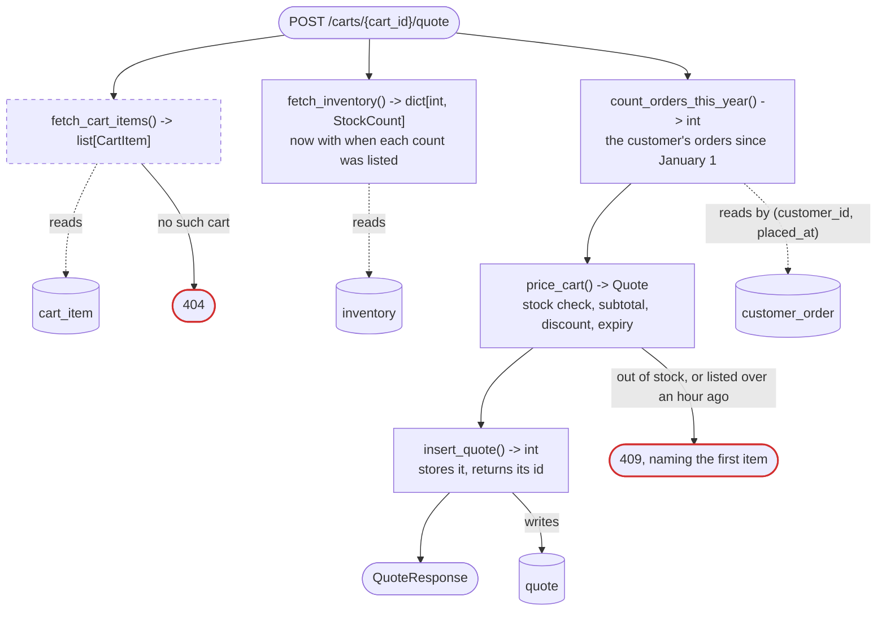
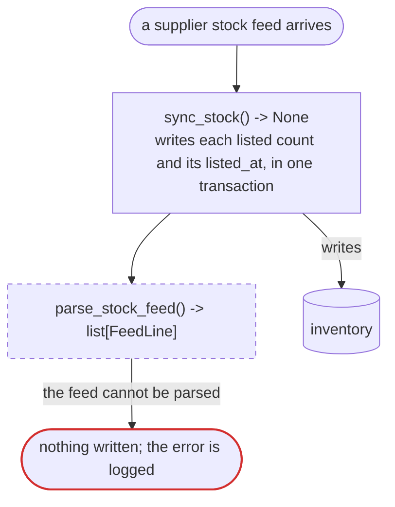

# Feature: repeat-order-discount

A sample Definition and Contract for an invented plan in an invented shop. It shows the
level of detail each section takes. Its code is Python and SQL; write a real plan in the
codebase's own language.

# DEFINITION

## Feature Description

A shopper who has ordered before this year gets a discount when their cart is priced. A
price quote stops being honored 30 minutes after it is issued, and is never priced on a
stock count the shop cannot vouch for.

## User Story

As a returning shopper, I want my earlier orders to lower my price, so that buying here
again is worth it.

## Problem Statement

A returning shopper pays what a first-time shopper pays. A quote is honored forever, so a
shopper can hold one across a price rise: last quarter 140 orders were placed on quotes
more than a day old, 31 of them after a rise. A quote can also be priced on a stock count
the supplier sent hours ago: 9 refunds last quarter were for items sold after they had run
out.

## ACCEPTANCE CRITERIA

1. Given a shopper with 4 or more orders this year, when they ask for a quote, then it
   takes 10% off the subtotal.
2. Given a shopper with 1 to 3 orders this year, when they ask for a quote, then it takes
   5% off; with none, 0%.
3. Given a shopper whose only orders were placed last year, when they ask for a quote,
   then it takes 0% off.
4. Given an item out of stock, when the shopper asks for a quote, then no quote is stored
   and the reply names the first such item.
5. Given an item the supplier's feed has not listed in the last hour, including one it has
   dropped or has not listed since this change, when the shopper asks for a quote, then
   that item counts as out of stock.
6. Given a quote issued 30 or more minutes ago, when it is read, then it is refused as
   expired.
7. Given a quote issued before this change, when it is read, then it is refused as
   expired.
8. Given no such cart, when the shopper asks for a quote, then the reply is not found.
9. Given the same feed arrives twice, when the stock sync runs on it again, then nothing
   changes.

## Solution Statement

Price the cart where quotes are already made, add a count of this year's orders, stamp each
quote with an expiry, and have the stock sync record when the supplier last listed each
item.

Like today's cart quote, except:

- a shopper with orders this year gets a repeat discount on the subtotal
- a quote carries an expiry, and reading one past it is refused
- an item the supplier has not listed in the last hour counts as out of stock

Reuses: today's cart read, stock read, and quote table. Copies: nothing.

Decisions:

- **Discount by orders this year**, not by lifetime spend. A count is one indexed read, and
  spend needs a sum over every order. Wrong if the discount must follow spend: then each
  customer needs a running total.
- **Out of stock refuses the whole quote**, not a partial one. A shopper never pays for a
  cart they cannot receive. Wrong if refused carts are abandoned more than partial ones
  would be. (yours)
- **The expiry is stored on the quote**, not worked out from when it was made. Changing the
  30 minutes later must not move quotes already issued. Wrong if issued quotes must follow
  a changed window.
- **A count the supplier has not sent in an hour counts as none**, not as current. Selling
  stock that is gone costs a refund, and a late feed costs a refused quote. Wrong if the
  feed's normal gap grows past an hour: then the cut-off moves with it.

Will not do:

- Renewing an expired quote: the shopper asks for a new one.
- A discount by coupon or by lifetime spend: each waits for its own plan.

Also changes:

- A quote issued before this change has no expiry and reads as expired, so a client
  holding one must ask again.
- Until the first feed after release arrives, up to 15 minutes, every quote is refused as
  out of stock.
- The web client shows the discount line and the time left on a quote. It ships after the
  API.
- The API schema file is regenerated, and one decision record is written.

Assuming:

- The supplier sends a full stock list about every 15 minutes, and sometimes late.
  `measured from the feed's arrival log, 30 days to 2026-10-01`: median gap 15 minutes,
  longest 2 hours 10 minutes, over an hour 4 times.

# CONTRACT

Size: 3 entry points, 2 tables, 8 functions, 4 models

## What changes for the user

- Today: a quote at the cart's full price, with no expiry. After: a quote with the repeat
  discount and a 30-minute expiry, or a refusal naming the first item out of stock, at
  `POST /carts/{cart_id}/quote`.
- Today: any stored quote, forever. After: the quote until its expiry, then a refusal, at
  `GET /quotes/{quote_id}`.
- Today: the stock sync writes each listed item's count. After: it also stamps when the
  supplier listed it, at the stock sync job.

```python
# NEW. Writes one quote. No outside call.
# Answers 200 with the quote, its total and expiry; 404 when there is no such
# cart; 409 when an item is out of stock or its count is stale, naming the first.
@router.post("/carts/{cart_id}/quote")
def create_cart_quote(cart_id: int, context: AppContext) -> QuoteResponse

# CHANGED. Now answers 410 once the quote has expired; today, 200 forever.
@router.get("/quotes/{quote_id}")
def read_quote(...) -> QuoteResponse

# CHANGED. Now stamps listed_at on every item the feed lists.
@scheduler.on_arrival("supplier-stock")
def sync_stock(...) -> None
```

## Models

Served, what leaves this codebase:

```python
# Returned by create_cart_quote and read_quote.
class QuoteResponse(BaseModel):
    quote_id: int
    subtotal_cents: int
    discount_percent: int   # 0, 5, or 10. From the shopper's orders since January 1.
    total_cents: int
    expires_at: datetime    # when this quote stops being honored. From the time it was priced, plus 30 minutes.
```

Stored, tables added or changed:

```sql
ALTER TABLE quote ADD COLUMN expires_at timestamptz;   -- From price_cart. NULL on a quote issued before this change.
-- Row model: Quote, gains expires_at.

ALTER TABLE inventory ADD COLUMN listed_at timestamptz;
-- From the supplier feed's own sent-at time, measured on 30 days of feeds to 2026-10-01.
-- Missing: NULL until the first feed after this change lists the item.
-- Changes: on every feed that lists the item, about every 15 minutes.
-- Disappears: never deleted. An item the supplier drops keeps its last listed_at, which ages past an hour.
-- Row model: Inventory, gains listed_at.
```

## How it works



Run again: a second quote is stored, and the first stays valid until it expires. Stops
midway: nothing is written before insert_quote, so a failure before it stores nothing.


Run again: nothing is written.



Run again: the same feed writes the same counts and the same listed_at, so nothing
changes. Stops midway: the transaction rolls back and the last full feed stays, aging
until the next one arrives.

Traced on one value: the total on Thad's quote, asked at 10:00.

```
Thad's cart                       unit price   supplier last listed it
  2 x notebook                      $30.00       09:52
  1 x desk lamp                     $40.00       09:45
Thad's earlier orders this year   4

stock      both listed within the hour (8 and 15 minutes ago)   → in stock
subtotal   2 x 30.00 + 40.00                                    → $100.00
discount   this is their 5th order this year                    → 10%
total      100.00 less 10%                                      → $90.00
expires    10:00 plus 30 minutes                                → 10:30

served     QuoteResponse
             quote_id           812
             subtotal_cents     10000
             discount_percent   10
             total_cents        9000
             expires_at         10:30
```

Asked at 10:46 instead, the lamp was listed 61 minutes ago, so the reply is 409 naming the
lamp (AC #5).

Also:

1. A total is whole cents. A fraction of a cent rounds down.

System footprint:

- Reads: cart_item, inventory and customer_order, one indexed read each per quote. Measured
  at 2 ms for a customer with 400 orders this year.
- Writes: quote, one row per quote. inventory, one row per listed item per feed.
- Calls: none.
- Shared limits: one connection from the API's pool of 20 per quote, for about 3 ms. Peak
  use measured at 11 of 20 last month; the sync uses its own pool.
- Shows it broke: the sync logs `stock sync: <N> items, sent <time>` on every feed, even one
  with no changes, so a quiet supplier still logs. No line for over an hour means the feed
  stopped. A 409 logs `stale` or `out`, so a late feed reads differently from stock that
  is truly gone.
