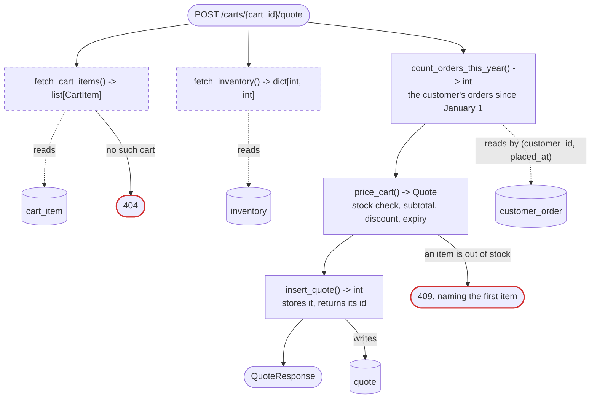
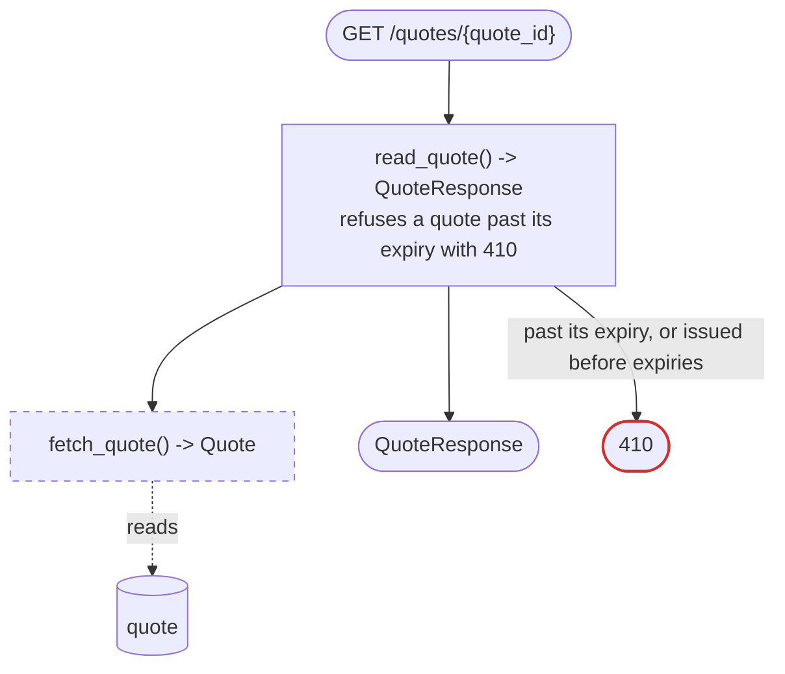

# Feature: repeat-order-discount

A sample Design part for an invented plan in an invented shop. It shows the level of
detail each section takes. Its code is Python and SQL; write a real plan in the
codebase's own language.

# DESIGN

Size: 2 entry points, 1 table, 6 functions, 2 models

## What gets built

A shopper who has ordered before gets a discount when their cart is priced. A
price quote now stops being honored 30 minutes after it is issued.

Like today's cart quote, except:

- a shopper with orders this year gets a repeat discount on the subtotal
- a quote carries an expiry, and reading one past it is refused

As a returning shopper, I want my earlier orders to lower my price, so that
buying here again is worth it.

## Out of scope

- Renewing a quote that has expired: the shopper asks for a new one.
- A discount by coupon or by lifetime spend: each waits for its own plan.

## Surface

```python
# NEW. Writes one quote. No outside call.
# Answers 200 with the quote, its total and expiry; 404 when there is no such
# cart; 409 when an item is out of stock, naming the first one.
@router.post("/carts/{cart_id}/quote")
def create_cart_quote(cart_id: int, context: AppContext) -> QuoteResponse

# CHANGED. Now answers 410 once the quote has expired; today, 200 forever.
@router.get("/quotes/{quote_id}")
def read_quote(...) -> QuoteResponse
```

## What else changes

- A quote issued before this change has no expiry and reads as expired, so a
  client holding one must ask again.
- The web client shows the discount line and the time left on a quote. It
  ships after the API.
- The API schema file is regenerated, and one decision record is written.

## Decisions

- **Discount by orders this year**, not by lifetime spend. A count is one
  indexed read, and spend needs a sum over every order.
- **Out of stock refuses the whole quote**, not a partial one. A shopper never
  pays for a cart they cannot receive.
- **The expiry is stored on the quote**, not worked out from when it was made.
  Changing the 30 minutes later must not move quotes already issued.

## The path





## Functions

```python
# ── POST /carts/{cart_id}/quote, in order ──

# Route handler. Loads the cart, runs the three steps below, and returns
# the quote.
def create_cart_quote(cart_id: int, context: AppContext) -> QuoteResponse

# One SQL statement. Counts the customer's orders placed since January 1.
def count_orders_this_year(
    connection: Connection, customer_id: int, today: date
) -> int

# Refuses when an item is out of stock. Otherwise sums the lines, applies
# the repeat discount, and stamps the expiry.
def price_cart(
    items: list[CartItem], stock: dict[int, int], order_count: int,
    now: datetime,
) -> Quote

# Existing, changed. Stores the quote with its expiry.
# Today: stores the quote with no expiry.
def insert_quote(...) -> int

# ── GET /quotes/{quote_id}, in order ──

# Existing, changed. Answers 410 when the quote has expired or has no
# expiry.
# Today: returns any stored quote.
def read_quote(...) -> QuoteResponse

# ── helpers the steps call ──

# The percent off for a customer's Nth order this year.
def repeat_discount_percent(order_count: int) -> int

# ── other new or changed functions ──

# none
```

## Models

Served, what leaves this codebase:

```python
# Returned by create_cart_quote and read_quote.
class QuoteResponse(BaseModel):
    quote_id: int
    subtotal_cents: int
    discount_percent: int   # 0, 5, or 10
    total_cents: int
    expires_at: datetime    # when this quote stops being honored
```

Stored, tables added or changed:

```sql
ALTER TABLE quote ADD COLUMN expires_at timestamptz;
-- Row model: Quote, gains expires_at.
```

Internal, what moves between the steps:

```python
# Existing, gains 1 field. Built by price_cart, stored by insert_quote.
# Assumes every quote stored after this change carries an expiry.
class Quote(BaseModel):
    ...
    # None on a quote issued before this change.
    expires_at: datetime | None
```

## Rules

Traced on one value: the total on Thad's quote, asked at 10:00.

```
Thad's cart                       unit price
  2 x notebook                      $30.00
  1 x desk lamp                     $40.00
Thad's earlier orders this year   4

subtotal   2 x 30.00 + 40.00                         → $100.00
discount   this is their 5th order this year         → 10%
           their 2nd, 3rd, or 4th would get 5%; their 1st, 0%
total      100.00 less 10%                           → $90.00
expires    10:00 plus 30 minutes                     → 10:30

served     QuoteResponse
             quote_id           812
             subtotal_cents     10000
             discount_percent   10
             total_cents        9000
             expires_at         10:30
```

Also:

1. An order placed last year does not count toward the discount.
2. If the lamp is out of stock, no quote is stored and the reply names the
   lamp.
3. A quote read at 10:30 or later answers 410.
4. A total is whole cents. A fraction of a cent rounds down.

## When it can't answer

- No such cart: 404.
- An item out of stock: 409 naming the first one, and nothing is stored.
- A cart with no items: a quote of $0.00.
- An expired quote: 410, and the client asks for a new one.

## Cost and proof

- Cost: one more indexed read per quote and no outside call. Measured at 2 ms
  for a customer with 400 orders this year.
- Proof: the discount is unit-tested at each boundary, and the route test
  checks the $90.00 above against hand-computed cents.
