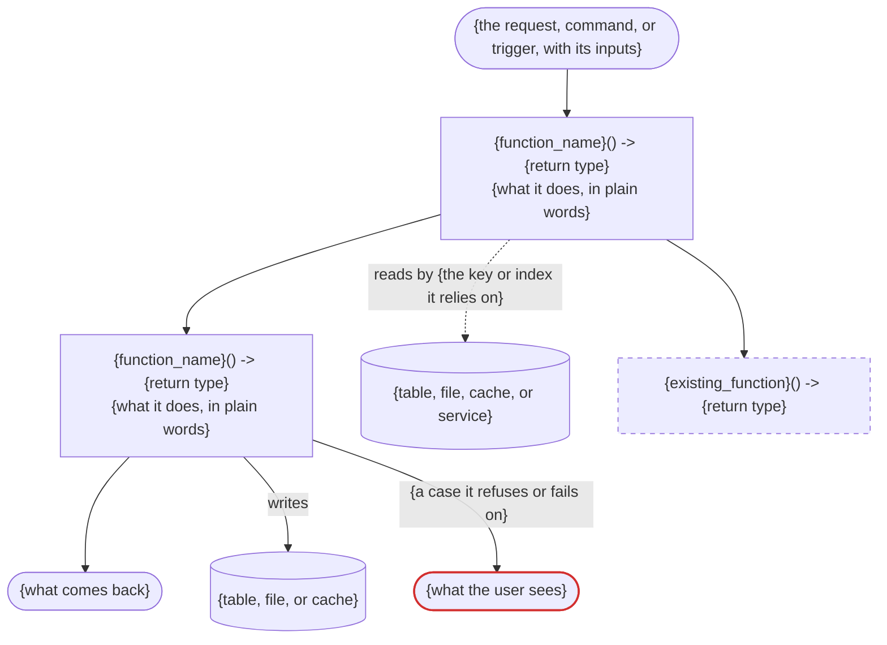

# Plan template

A plan has three parts. The developer reads the Definition and the Contract and confirms
them before the Build part is written. The executor builds from all three.

- The Definition is plain words. A reader who knows the product but not the code can judge
  it: is this the right thing, and the right approach?
- The Contract is code and diagrams: what changes for whoever calls it, the models, and how
  it works. The models are the contract the code is written to.
- Each section answers the question in its placeholder, and only that. A task never
  restates another section. It points at it: a function or a model by name, a criterion by
  number, a rule or a case by its opening words. A fact written twice gets changed in one
  place.
- Fill every section. One with nothing to report says `none`, because "no migration" is
  information. Never leave placeholder text under a heading. The executor will implement
  it.
- Write every code block in the codebase's own language. The skeleton shows Python and
  SQL.
- The Definition and the Contract name no source file, test, or line number. The Build part
  carries those.

---

````markdown
# Feature: <feature-name>

# DEFINITION

## Feature Description

<What is it, what is it for, and what is it worth to its users? Two sentences, with no
function or model name.>

## User Story

As a <type of user>, I want to <action/goal>, so that <benefit/value>.

## Problem Statement

<What is wrong or missing today, for whom, and what shows it?>

## ACCEPTANCE CRITERIA

<What must observably be true when it is done, including when its inputs go wrong?
Numbered, one each. Each is provable by a test or a named manual check. Tasks cite them by
number (AC #3), so the numbering is fixed once written.>

1. Given <the starting state>, when <the trigger>, then <what is observably true>.

## Solution Statement

<How does it solve the problem? The approach, in a few sentences.>

Like <the existing feature it copies>, except:

- <one place it differs, and why, in one line>

<When no existing feature is close, replace the list with one sentence on what it is
built from.>

Reuses: <what it calls as it is>. Copies: <what it duplicates, and how many copies there
will be>.

Decisions:

- **<what was chosen>**, not <what was rejected>. <Why, in one sentence.> Wrong if <the
  condition that would make it the wrong choice>. <`(yours)` when the developer made it.>

Will not do:

- <What this feature does not do, and why. A part that is not fully built is listed here.>

Also changes:

- <Existing behaviour that moves, and who sees it.>
- <Code or behaviour that is removed.>
- <Work another codebase must do, and which side ships first.>
- <Generated files that change, such as an API schema, and kept documents, such as a
  changelog.>

Assuming:

- <A fact about outside data the criteria rest on>. <`measured <how>, <when>`, or the
  Prerequisite that checks it.>

# CONTRACT

Size: <N> entry points, <N> tables, <N> functions, <N> models

## What changes for the user

<What does each caller get today, and what will they get after? One line per change, for
whoever meets it: a person, a screen, or another service.>

- Today: <what they get now, or nothing>. After: <what they get, in each case>, at <the
  endpoint, command, job, or view>.

```python
# NEW. <What it may read, write, or call.>
# Answers <outcome> when <cause>; <outcome> when <cause>.
<the line that registers it, as the codebase writes it: a route, a command, a job>
def <name>(
    <input>: <type> = <default>,   # <its bounds, or how it pairs with another>
) -> <return type>

# CHANGED. Now <what a caller sees differently>.
def <name>(...) -> <return type>
```

## Models

<What does each model hold, and where does every value come from?>

Served, what leaves this codebase:

```python
# <Which function returns or builds it.>
class <Name>:
    <field>: <type>   # <its meaning, worded as a caller will read it>. From <where its value comes from>.
```

Stored, tables added or changed:

```sql
CREATE TABLE <name> (        -- a changed table is an ALTER TABLE
    <column> <type>,         -- From <where its value comes from>.
    PRIMARY KEY (<columns>)
);
-- Row model: <Name>, one field per column. It is not listed again.
CREATE INDEX <name> ON <table> (<columns>);   -- <the new query that needs it>
```

## How it works

<What runs, in what order, what does it read and write, and where does it refuse or fail?>



Run again: <what a second run on the same input does>. Stops midway: <what is left
written, and what the next run does with it>.

Traced on one value: <what it is, for whom, asked at what moment>.

```
<the inputs, as a small table of example values>

<step>   <the arithmetic or check on those inputs>   → <result>
<step>   <the next step>                             → <result>

served   <the model's name, or `stored` and the table's>
           <field>   <its value in this example>
```

Also:

1. <A rule the trace does not show and no criterion states, in one plain sentence with its
   case.>

System footprint:

- Reads: <each table, file, cache, or service, and how much one run reads, measured>.
- Writes: <each table, file, or cache>.
- Calls: <each outside service, and what a call costs>.
- Shared limits: <the connections, threads, quotas, or credits it takes, and the headroom
  left>.
- Shows it broke: <the record or log line that shows a failure, and how a quiet but
  healthy source looks different from a broken one>.

# BUILD

Check the names of existing utilities, types, and models against the code before you use
them. Import from the right files.

## Prerequisite

<`none`, or each condition that must hold before the build starts: a dependency to install,
an upstream change to land, a schema or API sync to confirm, an outside value to measure.>

- `<condition>`. <Who makes it hold.> Confirm it with `<command>`, or with the observable
  state that proves it.

**Do not execute this plan until each one holds.**

## Functions

```python
# ── <the first diagram's name>, in order ──

# <What the body does, in three lines at most.>
def <name>(<arguments>) -> <return type>

# Existing, changed. <What the body does after the change.>
# Today: <what it does now.>
def <name>(...) -> <return type>     # (...) unless the change is to its arguments

# ── helpers the steps call ──

# <What the body does.>
def <name>(<arguments>) -> <return type>

# ── other new or changed functions ──

# <A function that no diagram shows.>
def <name>(<arguments>) -> <return type>
```

## Internal models

```python
# <What moves between this feature's own functions. Which one builds it, which reads it.>
class <Name>:
    <field>: <type>

# Existing, gains <N> fields.
class <Name>:
    ...
    <new field>: <type>
```

## EDGE CASES

<Every condition the Contract's rules and refused branches have no room for,
grouped under the unit that owns it. For each unit, take every input it reads and every
state that input can be in: absent, loading, in-flight, empty, denied, failed with nothing
held, and failed while an earlier value is still held. Write the line for each state, and
for each two that can happen together. Add logic that throws or returns a wrong answer
(boundary values, malformed input), and every case where two rules apply at once, with the
rule that wins. For each value from outside the codebase, add how it changes over time: not
set yet, late, corrected, renamed, removed.>

`<unit>`:
- <condition, and the input that reaches it>: <what must happen>

**Every line here becomes a named test. So does every acceptance criterion, every rule in
the Contract, each diagram in How it works end to end, each refused branch on it, and each
Run again, Stops midway, and Shows it broke line. A test that walks none of these adds its
case here first.**

## CONTEXT REFERENCES

### Relevant codebase files: READ THESE BEFORE IMPLEMENTING

<Files with line numbers and relevance.>

- `path/to/file` (lines 15-45). Why: the pattern for X that this mirrors
- `path/to/model` (lines 100-120). Why: the data model structure to follow
- `path/to/test`. Why: the test pattern to follow

### New files to create

- `path/to/new-service`: the service implementation for X
- `path/to/new-model`: the data model for Y
- `path/to/new-service-test`: unit tests for the new service

### Relevant documentation: READ THESE BEFORE IMPLEMENTING

- [Doc link](https://example.com/doc#section)
  - Specific section: authentication setup
  - Why: required for the secure endpoint
- `.agents/documentation/<name>.md`
  - Specific section: <heading>
  - Why: the decision this project already made about X

### Patterns to follow

<Patterns from this codebase the executor must match, each as `file:line` with what to
take from it: naming, error handling, logging.>

## STEP-BY-STEP TASKS

Execute in order, top to bottom. Number the tasks. Each one is atomic, names the files it
changes, and leaves every test passing. The executor should never have to go discover a
file.

Group tasks under `### Phase N: <the work it delivers>` headers when the work spans
stages. A phase assumes the one above it is done. Where that is not the true dependency,
add a `**Depends on:**` or an `**Independent of:**` line under its header. Independent
phases can run in parallel.

Start each task title with an action keyword, then add short bullets saying exactly what
changes:

- **CREATE**: new files
- **UPDATE**: existing files
- **REMOVE**: code or behaviour that goes. Its tests go with it, or change to say what
  happens now
- **REFACTOR**: restructure without changing behaviour. It adds no test and changes no
  assertion: the existing tests, passing before and after, are its proof
- **MIRROR**: follow the shape of existing code. Count the places that already hold the
  same logic and say the number: a third copy is a REFACTOR first, unless a project rule
  says otherwise
- **VERIFY**: run a check that changes no file. It builds nothing and writes no tests, so
  it has only a VALIDATE

A CREATE, UPDATE, REMOVE, REFACTOR or MIRROR task has these three fields:

- **BUILDS**: the functions and models this task delivers, by name. Never restate them.
- **TESTS**: the named tests this task writes before its code, each with what it proves:
  a criterion (AC #3), an EDGE CASES line, or a Contract rule, by its opening words. A
  task writes the tests for the code it adds, never a later task. `none` says why, as a
  REFACTOR's does.
- **VALIDATE**: `<executable command>` that runs this task's tests. For a task with nothing
  to test, such as a migration, it shows the result. A type check or a lint alone shows
  the code compiles, not that it works.

Add these only when the task needs them:

- **PATTERN**: the existing code to mirror, as `file:line`.
- **IMPORTS**: the exact imports, when they are not obvious.
- **GOTCHA**: a known constraint that would trip up the executor, such as framework
  behavior, ordering, or a type quirk.

When an algorithm is too involved for Functions and the Contract to carry, sketch it in
pseudocode under the task that owns it: the loop, the branches, where the transaction or
state update happens.

## VALIDATION COMMANDS

<The real commands from this project, each one run while planning, or marked `not run`
with the reason. Every one must be non-interactive.>

Run every command. Together they prove no regressions and a correct feature.

- **Level 1: Syntax and style.** <lint, format, and type-check commands>
- **Level 2: Unit tests.** <unit test command>
- **Level 3: Integration tests.** <integration test command>
- **Level 4: Manual validation.** <feature-specific steps>

  Cover every state the feature renders, not only the one where everything works: empty,
  loading, error, denied. For a UI change, check keyboard focus and run an accessibility
  check on the changed view.

  Run the feature once against each real outside source it reads, read-only, and compare
  what comes back with what the plan measured. A run that needs a key or money the
  developer has not given is marked `not run`, with what it would have shown.

- **Level 5: Additional.** <any other check this feature needs>

  Measure each shared limit the System footprint names while the feature runs, and
  compare it with the headroom the plan claims.

## NOTES

<Your decisions that nobody outside the code would see, one line each, and context the
sections above have no home for.>
````

---

## Rules the skeleton cannot show

- **ACCEPTANCE CRITERIA.** Each criterion about something going wrong names the input and
  the state it is in: missing, empty, late, duplicated, changed, removed, half-failed, run
  twice, run at the same time, or at a boundary.
- **Solution Statement.** At most five decisions: the ones that set the shape, such as
  where the feature lives, which side does which work, or what the data is keyed by,
  whoever made them. A choice with no rejected alternative is not a decision. The rest go
  under `## NOTES`. Under `Copies`, a third copy of the same logic is a refactor, and says
  so.
- **Assuming.** A fact that belongs to one field goes in that field's comment in Models,
  not here. This list holds what no single field carries: how often the data arrives, how
  late it can be, whether it is complete.
- **What changes for the user.** For a screen, draw it under its line, in each state that
  changes the layout. Where the plan rests on size, colour or spacing, say under the sketch
  whether the developer has seen it rendered.
- **Models.** Name a field with the word the developer or the code already uses for the
  thing. Where neither has one, list your name under `## NOTES` with the name you
  rejected. An existing model appears in full only when a new or changed function
  returns it, marked `Existing, unchanged`. One that a new model nests appears only as a
  field's type. Say in a model's comment what it reuses from an existing model.
- **A value from outside the codebase** answers, in its field's comment: where it comes
  from; how it was checked, as `measured <how>, <when>`, or the Prerequisite that checks
  it; whether it can be missing; whether it can change after it is first seen; and whether
  it can disappear. Each yes has a criterion.
- **How it works.** One diagram for each change in What changes for the user, such as a
  job that writes and a route that reads. Every function the plan adds or changes is a
  node on some diagram. An existing function called unchanged is a dashed `reused` node.
  Each table, file, cache, or service a step reads or writes is a cylinder, joined by a
  `reads` or `writes` edge. A new query's `reads` edge names the key or index it relies
  on. Each case where a step refuses or fails is an edge from that step, labelled with its
  cause, to a `refused` node naming what the user sees. Mermaid drops anything that looks
  like a tag, so write `<` and `>` in a label as `#lt;` and `#gt;`. A diagram that writes
  nothing says `Run again: nothing is written.` and leaves out `Stops midway`.
- **Traced on one value.** Pick a value whose numbers include a tie or a boundary when the
  feature has one. For a feature that writes, follow one record to its stored row. Two
  behaviours that share no step get a trace each. Number at most six rules under `Also`,
  and never restate a criterion there. The rest go under `## EDGE CASES`.
- **System footprint.** A shared limit with no measured use says `not measured`, and
  becomes a Prerequisite when the feature adds a steady user of it.
- **EDGE CASES.** Each line names the input that reaches it. Where no real input can, the
  line says so, and its test reaches it through a stand-in.
- **Functions.** A function appears once. Leave out test code: fixtures, doubles, and
  seeding helpers. List a style rule or a stored query the same way: its name and what it
  does.
- **TESTS.** Before the plan is done, check that every test the EDGE CASES section calls
  for is in some task's TESTS. One that is in none is built by nobody. A test of data from
  outside the codebase names the saved sample under `.agents/samples/` that it runs on. If
  nothing has been measured yet, the test waits for the Prerequisite that measures it.

  ❌ `The test gives the parser a reply the planner wrote by hand.`

  ✅ `The test gives the parser the reply saved from the real service.`
