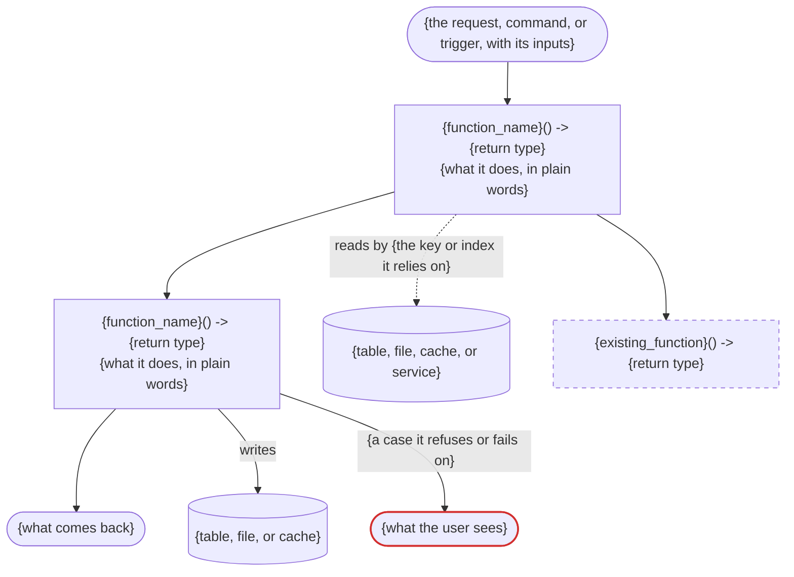

# walk-plan: the plan as the developer needs to see it

## Plan: $ARGUMENTS

Goal: the developer judges the design before anything is built. A plan is written for
whoever implements it, with every detail they need, so it runs long. The developer needs a
different cut of the same facts: what the work touches, why it has this shape, and what
the code will be named.

Change nothing in the plan or the code. Write the walkthrough to
`.agents/walks/<the plan's file name>`, replacing any earlier one, and open it with the
`annotate` skill, so its diagrams draw and the developer can comment line by line. It is a
view of the plan, not a record. Comments sent from the page are handled as `annotate` says.
Without the `annotate` skill, the walkthrough is the reply, and its diagrams show as their
source.

If the plan path is missing or the file cannot be read, say so and stop.

## 1. Read

Read the plan file in full, even when this session wrote it. The implementer gets the
file, so the walkthrough describes the file.

Two sources answer a section:

- **The plan** is the only source for anything the plan adds or changes.
- **The code** answers only for what exists today: the tables a query reads, an entry
  point's address, what an existing function returns before the change.

Report the plan. Never repair it in the walkthrough.

- A name appears exactly as the plan spells it. The developer is judging the real names.
- When the plan leaves out something a section needs, write `not stated in the plan` in
  that place. A return type the plan never gives reads `-> not stated in the plan`. Each
  such line shows the developer a hole in the plan.

## 2. Write

Use the size line and these ten sections, in this order, every time. A section or a
group with nothing to report says `none`, because "no migration" is information.

Write every code block in the plan's own language. The skeleton shows Python and SQL.

````markdown
# Walkthrough: <plan name>

Size: <N> entry points, <N> tables, <N> functions, <N> models

## What gets built

<Two sentences in plain words: what exists afterwards that is not there today.>

## Surface

```python
# NEW. <What it may read, write, or call, and what a call costs.>
# Answers <outcome> when <cause>; <outcome> when <cause>.
<the line that registers it, as the codebase writes it: a route, a command, a job>
def <name>(
    <input>: <type> = <default>,   # <its bounds, or how it pairs with another>
) -> <return type>

# CHANGED. Now <what a caller sees differently>.
def <name>(...) -> <return type>
```

## What else changes

- <Existing behaviour that moves, and who sees it.>
- <Code or behaviour that is removed.>
- <Work another codebase must do, and which side ships first.>
- <Generated files and records that change.>

## Decisions

- **<What was chosen>**, not <what was rejected>. <Why, in one sentence.>

## The path



## Functions

```python
# ── <the first path's name>, in order ──

# <What the body does.>
def <name>(...) -> <return type>

# Existing, changed. <What the body does after the change.>
# Today: <what it does now.>
def <name>(...) -> <return type>

# ── helpers the steps call ──

# <What the body does.>
def <name>(...) -> <return type>

# ── existing, changed ──

# <A changed function that no path above lists.>
# Today: <what it does now.>
def <name>(...) -> <return type>
```

## Models

Served, what a caller receives:

```python
# <Which function returns or builds it.>
class <Name>:
    <field>: <type>   # <its meaning, when the name does not carry it>
```

Stored, tables added or changed:

```sql
CREATE TABLE <name> (
    <column> <type>,
    PRIMARY KEY (<columns>)
);
-- Row model: <Name>, one field per column.
CREATE INDEX <name> ON <table> (<columns>);   -- <the new query that needs it>
```

Internal, what moves between the steps:

```python
# Existing, gains <N> fields. <Which function builds it and which reads it.>
class <Name>:
    ...
    <new field>: <type>
```

## Rules

Traced on one value: <what it is, for whom, asked at what moment>.

```
<the inputs, as a small table of the plan's own example or test values>

<step>   <the arithmetic or check on those inputs>   → <result>
<step>   <the next step>                             → <what the user sees>
```

Also:

- <A rule the trace does not show, in one plain sentence with its case.>

## When it can't answer

- <A missing-data or refused case>: <what the user sees>.

## Cost and proof

- Cost: <measured time and size with their sample, anything metered, caching>.
- Proof: <how the tests show the result is right, in one sentence>.
````

What each part holds:

- **Size.** Count what the plan adds or changes. The numbers tell the developer how big
  the plan is before they read it.
- **What gets built.** No function or model name. A reader who stops here knows what
  changed for the user.
- **Surface.** Every entry point the plan adds or changes: an HTTP route, a command, a
  screen, a scheduled job, an event handler, or a library's public function, as its
  registration line and signature. The comment above it says what it may read, write, or
  call, and each outcome with its cause. A call's cost is stated when the project meters
  calls. An input's bounds or default is a comment on its argument.
- **What else changes.** At most five bullets. Generated files are ones a tool rebuilds
  from the code, such as an API schema or generated types. Records are documents the
  project keeps, such as a decision record or a changelog.
- **Decisions.** At most five. Pick the ones that set the shape: where the feature lives,
  which side does which work, what the data is keyed by. A decision with no rejected
  alternative stays in the plan.
- **The path.** One diagram for each path, such as a job that writes and a route that
  reads. Every function the plan adds or changes is a node on some path, in call order. An
  existing function the path calls unchanged is a dashed `reused` node. Each table, file,
  cache, or service a step reads or writes is a cylinder, joined by a `reads` or `writes`
  edge. A new query's `reads` edge names the key or index it relies on. Each case where a
  step refuses or fails is an edge from that step, labelled with its cause, to a `refused`
  node naming what the user sees. Mermaid drops anything that looks like a tag, so write `<`
  and `>` in a label as `#lt;` and `#gt;`.
- **Functions.** Every function the plan adds or changes, one group per path block in the
  same order, then the helpers, then any changed function no path lists. A function
  appears once. Arguments stay as `(...)`. The comment says what the body does, in at
  most three lines, so the developer can check each name against its body. Leave out test
  code: fixtures, doubles, and seeding helpers.
- **Models.** Every type, schema, and table the plan adds or changes, as real code with
  fields exactly as the plan gives them. Transcribe a table the plan describes in a column
  list into `CREATE TABLE`, and a changed table into `ALTER TABLE`. A row model that
  mirrors its table gets the one comment line under the table, never a second listing. An
  existing model appears in full only when a new or changed function returns it, marked
  `Existing, unchanged`. An existing model that a new model nests appears only as a
  field's type.
- **Rules.** Follow one value a user will see from its inputs to what they are shown,
  with the plan's own example or test values. Each step shows its inputs, its arithmetic
  or check, and its result, so every rule arrives with the case that needs it. Pick a
  value whose numbers include a tie or a boundary when the plan has one. For a plan that
  writes, follow one record from where it enters to its stored row. Under `Also`, give
  each rule the trace does not show as one plain sentence with a case, at most six. Use
  no term the trace has not shown. When the plan carries no worked values, write
  `not stated in the plan` in place of the trace.
- **When it can't answer.** At most five cases, chosen from the cases the plan lists:
  the ones a user of the feature would see.
- **Cost and proof.** One bullet each.

The first six sections stay short whatever the plan's size. Functions and Models run as
long as the plan needs. Never drop a function or a model to shorten them: their length is
the plan's size, and the developer is reading for it.

## 3. Check

Before opening it, hold the walkthrough to these.

- No file path, test name, validation command, line number, or implementation warning
  appears, and no argument list outside Surface. The plan carries those for the implementer.
- A function comment says what the body does. Why the design was chosen belongs under
  Decisions.
- The walkthrough carries no opinion on a name, no recommendation, and no summary after the last
  section. The developer forms a view from Functions and Models.

`references/example.md` is one finished walkthrough of an invented plan. Read it before
writing, for the level of detail each section takes.
